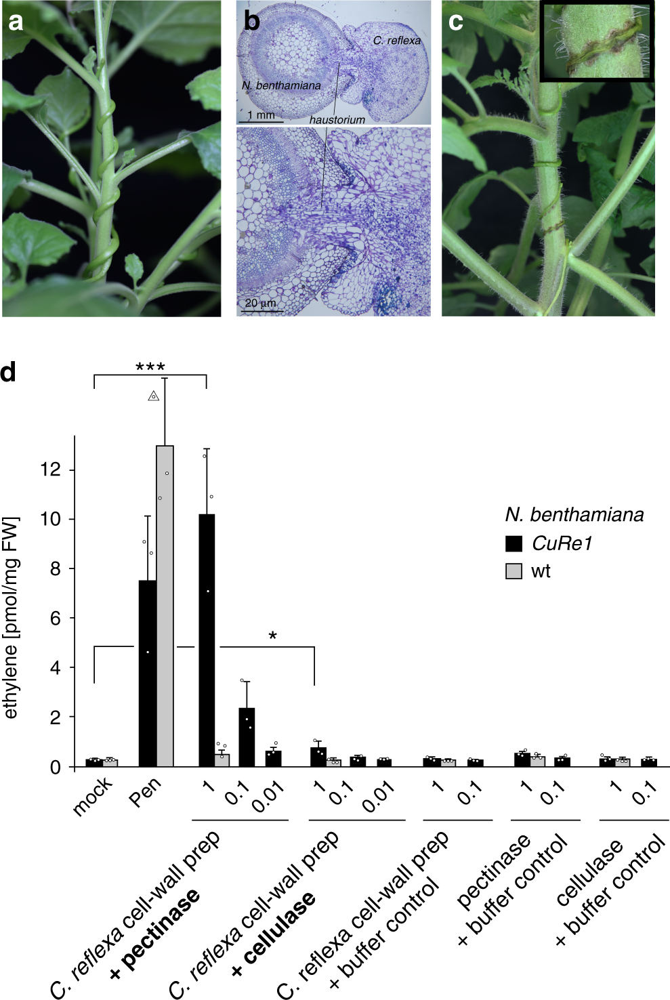

# 昆虫、线虫、寄生植物与挥发信号

植物面对的攻击者并不限于微生物。咀嚼昆虫移走组织，刺吸式昆虫进入特定取食空间，线虫改变根部取食位点，寄生植物建立与宿主的物质联系。这些关系既共享伤害、模式感知与激素网络，也有各自的解剖位置和生活史。本专题用INR、Mi-1和CuRe1三个例子，把这些对象接回植物免疫；再区分植物间挥发线索与招募害虫天敌的生态过程。

**学习目标。** 能区分机械损伤、攻击者相关线索和保护结局，解释HAMP的来源、寄生植物识别以及挥发物研究的对照逻辑。先修为[侵染循环](../learning/病理基础与侵染循环.md)、[第5章激素网络](../part2-分子机制/ch05-激素信号网络.md)与[第17章屏障](../part6-专题与研读/ch17-屏障与化学防御.md)。

## 1　先看取得资源的方式

| 对象 | 与宿主建立的关系 | 评价防御时应区分什么 |
|---|---|---|
| 咀嚼式昆虫 | 取食组织，同时引入唾液或口腔分泌物 | 机械伤害、分泌物线索、取食量和昆虫生长 |
| 刺吸式昆虫 | 以口针探测组织或取食特定液体 | 取食行为、繁殖表现、宿主损伤与媒介传播 |
| 植物寄生线虫 | 侵入组织，部分种类诱导持久取食位点 | 进入、位点形成、繁殖与根部功能 |
| 寄生植物 | 以吸器与宿主组织和维管系统建立联系 | 接触、附着、侵入、连接及寄生者后续生长 |
| 微生物病原 | 依各自生活史在适宜部位发展 | 病原负担、症状、传播与宿主损失 |

分类帮助我们选择问题，不自动给出激素处方。许多咀嚼相关防御与JA联系紧密，刺吸昆虫也可能显著涉及SA及其他信号；两者仍受物种、组织和攻击历史影响。昆虫携带病毒时，对昆虫的防御与对病毒复制、移动的限制又是两个层次。

## 2　植物怎样区别剪伤与取食

机械损伤会暴露细胞内容物并释放危险线索。昆虫取食则同时带来口器运动、取食节律、分泌物及其与宿主组织反应的产物。**植食者相关分子模式（herbivore-associated molecular pattern，HAMP）**描述与植食活动相关、可诱导植物响应的分子线索；并不是“昆虫中所有分子”的统称。

INR是一个很适合初学者的例子。Inceptin来源于植物叶绿体ATP合酶γ亚基的蛋白片段，经昆虫取食加工后出现在口腔分泌物中。它的材料来源是植物，形成和呈递却与植食活动相关。因此，外源与内源的简单二分，并不能完整解释植物怎样识别危险。

Steinbrenner等（2020）鉴定了部分豆科植物中的inceptin受体INR。它属于LRR-RLP，本身没有胞内激酶域，需要信号伙伴连接输出；研究将识别能力与防御及植食者表现联系起来。这个例子扩展了PRR的学习对象：表面模式感知可以涉及植食活动，而不只是真菌和细菌。[原始研究](https://doi.org/10.1073/pnas.2018415117)

阅读时可依次问：不同宿主材料对该线索是否有不同响应？候选受体能否解释差异？其表达是否赋予相应响应？是否观察到植食者表现改变？这些问题逐步推进受体功能，不能只凭一次ROS上升就宣布获得持久抗虫性。某些植物具有INR，也不意味着所有豆科都具有同样感知能力。

## 3　直接防御与间接防御需要不同结局

植物可通过组织性质、蛋白酶抑制剂及其他化学物质影响植食者；也可通过挥发物等改变第三方生物的行为。前者常被称为直接防御，后者涉及间接防御。但“产生某种物质”与“该物质实际减少宿主损失”仍需要连接。

| 观察 | 首先支持什么 | 若要解释保护，还应追问什么 |
|---|---|---|
| 某防御转录本上升 | 相关表达状态改变 | 蛋白或代谢产物是否改变？ |
| 幼虫质量或生长改变 | 植食者在该背景中的表现改变 | 摄食量、植物大小和营养差异怎样贡献？ |
| 昆虫减少取食或产卵 | 行为选择改变 | 是否只是转移到其他部位或植株？ |
| 天敌被吸引 | 定向或访问行为改变 | 是否进一步捕食、寄生并降低损失？ |
| 产量保持较好 | 特定背景中的农艺收益 | 该收益来自抗虫、耐受还是其他发育变化？ |

这一层次也提醒我们：植物防御不能只按组织里某个激素的多少排序，结局应与攻击者的资源获取方式相匹配。

## 4　线虫：发育重塑与免疫在同一部位交汇

根结线虫和胞囊线虫可使宿主形成特化取食结构；并非所有植物寄生线虫都采取完全相同的方式。一个根部膨大或细胞表达改变，既可能涉及宿主发育重塑，也可能包括免疫、营养与损伤。研究时应把进入根部、取食位点建立和繁殖成功分开。

番茄Mi-1是连接不同攻击者的经典案例。Vos等（1998）通过克隆与互补等证据，将这一抗性位点与对特定根结线虫及马铃薯长管蚜的抗性联系起来。它说明同一个抗性模块的功能范围可以跨越不同动物类群。[原始研究](https://doi.org/10.1038/4350)

这不等于该受体已经被证明直接结合一个所有害虫共有的分子，也不能把抗性推广到全部线虫和蚜虫。基因是否赋予功能、所感知的线索是什么、不同组织如何执行，是三个可以分开研究的问题。把Mi-1放回[第8章的间接识别](../part3-攻防博弈/ch08-植物的识别智慧.md)，有助于理解“遗传抗性范围”与“直接结合范围”的区别。

## 5　寄生植物：同属植物，也能成为被感知的攻击者

菟丝子与独脚金不是真菌。菟丝子以茎寄生为典型例子；独脚金常与根寄生研究相联系。二者都涉及吸器，但其生活史、寄生部位和宿主营养关系不同，不能把微生物吸器的全部机制直接套过来。

Hegenauer等（2016）鉴定番茄细胞表面受体CuRe1，将对菟丝子相关因子的响应与寄生抗性联系起来。2020年的后续研究进一步鉴定寄生植物细胞壁来源的富甘氨酸蛋白CrGRP及相关肽线索，连接配体身份和受体依赖感知。这是一条从“植物抵抗某寄生者”走向“感知了什么”的研究链。[2016研究](https://doi.org/10.1126/science.aaf3919) · [2020研究](https://doi.org/10.1038/s41467-020-19147-4)

### 真实原图：从吸器接触到受体相关响应 {#case-cure1-parasite}

{.paper-figure}

**Hegenauer V, Slaby P, Körner M et al.（2020），Figure 1 a–d。** *The tomato receptor CuRe1 senses a cell wall protein to identify Cuscuta as a pathogen.* Nature Communications 11:5299。[论文与图例](https://pmc.ncbi.nlm.nih.gov/articles/PMC7576778/#Fig1) · [DOI](https://doi.org/10.1038/s41467-020-19147-4) · [出版社原图](https://media.springernature.com/full/springer-static/image/art%3A10.1038%2Fs41467-020-19147-4/MediaObjects/41467_2020_19147_Fig1_HTML.png)。© The Author(s) 2020，[CC BY 4.0](https://creativecommons.org/licenses/by/4.0/)。完整原图未改动；点击可放大。

先看a—c。a展示易感本氏烟草上的缠绕，b切片帮助定位吸器与宿主组织的关系，c则是番茄接触部位的反应。三幅图涉及不同宿主，不能把它们排成同一植株被连续追踪的时间序列。外观与解剖使寄生关系变得直观，却不单独完成受体鉴定。

再看d。黑柱与灰柱分别表示具有CuRe1的本氏烟草材料与野生型；纵轴是按鲜重归一化的乙烯读数，不是病原数量或寄生成功率。Mock提供背景，Pen阳性参照说明两类材料都能作出另一类诱导响应。菟丝子材料相关的反应差异，由此更容易与CuRe1联系起来。

还要认真看横轴：有不同来源或处理的材料，并非所有柱子代表同一种纯配体。某些稀释位置没有野生型柱，是原图未在这些位置检测该材料，不能补画成零。图例将所示误差说明为技术重复的标准差，并另述独立重复，不能把三个点自动写成三株独立植物。

**本图适合支持的结论：**指定寄生关系存在组织反应，CuRe1相关背景对某些菟丝子来源材料具有不同响应。纯化因子的身份、特异结合以及最终抗性需要回到2016研究及2020论文其他图逐步连接，不能全部归功于这张Figure 1。

### 独脚金提示：减少接触与激活免疫也不同

独脚金种子感知宿主相关独脚金内酯线索，依靠自身的受体体系决定萌发。Toh等（2015）研究了其高灵敏度独脚金内酯受体。这是在解释寄生者怎样找到适宜宿主，不是说明宿主CuRe1怎样识别菟丝子，两者的受体所在生物都不同。[原始研究](https://doi.org/10.1126/science.aac9476)

因此，改变萌发线索使寄生接触减少，与宿主在侵入后激活免疫，是不同的抗寄生思路。独脚金内酯还联系植物发育和菌根互作，不能因其被寄生者利用，就把它视为只应删除的“坏信号”。相关共生背景见[第25章](../part8-免疫与微生物/ch25-共生识别与免疫协调.md)。

## 6　挥发信号至少包含三种不同关系

**挥发性有机化合物（volatile organic compounds，VOCs）**包括多类分子；绿叶挥发物（green leaf volatiles，GLVs）是其中一部分。水杨酸甲酯、甲基茉莉酸与不同GLV不能互相替代，也不能仅凭“青草味”就确定具体信号。

| 关系 | 信号的起点与终点 | 实际要检验什么 |
|---|---|---|
| 同株空气途径 | 一处组织释放，另一处暴露 | 是否通过空气产生作用，能否与内部运输区分？ |
| 株间线索 | 一株释放，另一株感知 | 接收植物的动态、预激或保护是否改变？ |
| 三营养级互作 | 植物改变气味，影响植食者天敌 | 天敌行为是否改变，是否带来捕食或寄生及宿主收益？ |

“招来天敌”属于第三类，不能当作已经证明第二类；“邻株钙信号上升”也不能代替田间减少虫害。信息可能被其他生物利用，使用“通讯”一词时还应区分接收反应与已证明的双方适应性收益。

## 7　把挥发物研究拆成准备、触发和结局

Engelberth等（2004）在玉米中比较了先前GLV暴露与后续伤害/植食相关刺激，将预激与当下直接诱导分开。学习重点是一个两阶段关系：先前暴露是否改变后来对特定输入的响应，而非只比较暴露后的一个终点。[原始研究](https://doi.org/10.1073/pnas.0308037100)

Aratani等（2023）则用拟南芥钙成像研究GLV感知的时空过程，把保卫细胞与内部组织的响应联系起来。它为“空气中的线索怎样进入组织并变成早期信号”提供具体入口；钙报告与防御相关表达仍需与昆虫表现、病原限制或产量等结局区分。[原始研究](https://doi.org/10.1038/s41467-023-41589-9)

阅读这类研究，应寻找来源植物、接收植物、空气或其他接触路径、背景气流，以及后续触发条件的明确比较。光照、湿度或来源植物释放的其他成分也会改变接收植物状态。对照逻辑的作用是识别路径，不能靠拟人化的“报警广播”替代它。

## 自测与解析

**1. 用剪刀造成与取食面积相同的伤口，就完全复制了昆虫攻击吗？**

没有。分泌物、加工后的宿主成分、伤害节律与取食位置等可能不同。面积匹配只是比较中的一个因素。

**2. Inceptin来源于植物蛋白，为什么仍可作为植食活动的线索？**

其加工和重新呈递与取食过程相关。材料来自哪里，与它在何种生态过程中出现，是两个问题。

**3. Mi-1在两类动物互作中有抗性功能，是否证明它直接结合两者的同一分子？**

没有。遗传功能范围不能代替直接识别证据，也可能涉及宿主状态或间接感知。

**4. CuRe1原图d中的乙烯更高，是否就表示寄生植物数量更少？**

不能。乙烯是指定条件下的响应读数，寄生建立、连接和生长是另一些需要直接观察的终点。

**5. 独脚金受体与番茄CuRe1属于同一个免疫识别体系吗？**

不是。前者帮助寄生者感知宿主相关萌发线索；后者参与宿主感知寄生植物。受体的来源、配体和生物学任务不同。

**6. 挥发物吸引天敌，是否已经证明邻株被预激？**

没有。天敌行为与接收植物应答是不同关系。后者还需要先前暴露、再次刺激及适合结局的比较。

## 参考文献

- Aratani Y et al. *Green leaf volatile sensory calcium transduction in Arabidopsis.* Nature Communications, 2023;14:6236. [DOI](https://doi.org/10.1038/s41467-023-41589-9)。
- Engelberth J et al. *Airborne signals prime plants against insect herbivore attack.* PNAS, 2004;101:1781–1785. [DOI](https://doi.org/10.1073/pnas.0308037100)。
- Hegenauer V et al. *Detection of the plant parasite Cuscuta reflexa by a tomato cell surface receptor.* Science, 2016;353:478–481. [DOI](https://doi.org/10.1126/science.aaf3919)。
- Hegenauer V et al. *The tomato receptor CuRe1 senses a cell wall protein to identify Cuscuta as a pathogen.* Nature Communications, 2020;11:5299. [DOI](https://doi.org/10.1038/s41467-020-19147-4)。
- Steinbrenner AD et al. *A receptor-like protein mediates plant immune responses to herbivore-associated molecular patterns.* PNAS, 2020;117:31510–31518. [DOI](https://doi.org/10.1073/pnas.2018415117)。
- Toh S et al. *Structure-function analysis identifies highly sensitive strigolactone receptors in Striga.* Science, 2015;350:203–207. [DOI](https://doi.org/10.1126/science.aac9476)。
- Vos P et al. *The tomato Mi-1 gene confers resistance to both root-knot nematodes and potato aphids.* Nature Biotechnology, 1998;16:1365–1369. [DOI](https://doi.org/10.1038/4350)。

[返回九维知识地图](../learning/植物免疫九维框架与拓展地图.md) · [继续读微生物组与免疫](ch10-植物微生物组与免疫.md)
