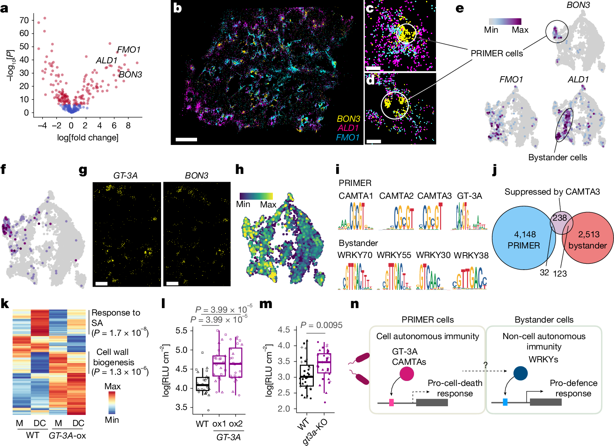

# 免疫输出与细胞空间协作

同一片受感染叶片里，有的细胞已经出现强烈防御，有的正在响应邻近信号，有的仍维持组织功能。整叶平均的“PR1上升”会把这些位置混在一起。本专题先连接钙、ROS、转录与代谢，再用PRIMER真实论文图解释细胞间分工，最后讨论NPR1怎样把防御与细胞存活联系起来。

**学习目标。** 能区分细胞身份与免疫状态、转录与翻译、ROS的来源与作用，并解释空间关联、遗传功能与信号传播之间的证据差别。先修为[第3章](../part2-分子机制/ch03-受体与信号转导.md)、[第5章](../part2-分子机制/ch05-激素信号网络.md)；初读时可先跳到PRIMER原图的b—e。

## 1　细胞自主防御怎样与组织协调共存

**细胞自主性（cell autonomy）**关注一个细胞内部的机制能否贡献其自身响应；**非细胞自主性（non-cell autonomy）**关注一个细胞的变化如何影响另一个细胞。植物许多细胞能够感知与执行防御，并不表示每个细胞都具有相同受体、相同代谢能力或相同输出阈值。

保卫细胞调节进入叶内的气孔通道，叶肉细胞参与光合与局部防御，维管组织相关细胞连接物质运输和系统反应。细胞身份提供资源与结构基础，感染历史又会改变活动状态。同一种叶肉细胞因此可能进入不同免疫状态；两类细胞也可能共享某些防御基因。

这给实验提出了一个实际问题：整叶某转录本增加，可能是每个细胞都增加，也可能是少数细胞强烈增加，或表达该转录本的细胞比例改变。解剖、成像与单细胞测量分别帮助拆开这些解释，不能只靠更高的测序深度代替空间信息。

## 2　用相互重叠的过程理解免疫时间

受体激活、离子变化、蛋白修饰、转录和代谢不是依次等前一步全部结束才启动。一个早期信号可以迅速改变现有蛋白，也能推动较晚的表达；后来的激素和蛋白周转又会反过来影响早期信号的持续性。

| 过程 | 生物学作用 | 阅读时先核对什么 |
|---|---|---|
| 钙相关动态 | 用位置、幅度、持续时间及频率组织信号 | 报告在哪个区室，是否相对荧光，空间位置怎样对应曲线？ |
| ROS产生与清除 | 参与信号、壁环境变化，并在过量时造成损伤 | 来源与位置、探针性质、清除过程和组织状态 |
| 激酶与磷酸酶 | 改变现有蛋白的活性或互作 | 直接修饰与遗传依赖是否被分别证明？ |
| 转录和翻译 | 改变RNA与蛋白质供给 | RNA积累与蛋白合成是否同时被测量？ |
| 分泌、代谢及细胞壁重塑 | 改变微生物所在环境与组织屏障 | 产物在哪里、是否具有保护作用及代价？ |
| 关闭与恢复 | 避免反应持续过度并维持组织功能 | 降解、负反馈和修复是否受到评价？ |

常说的“早期分钟级响应”与“较晚小时级响应”适合帮助选择观察窗口，不是各植物通用的标准时刻表。刺激入口、组织和检测方法不同，会改变所看到的先后；同一输出也可有快速与持续阶段。真实时间曲线的读法见[钙信号原图](../part7-研究技术与实验逻辑/钙信号与细胞死亡原图研读.md#case-calcium-waves)。

## 3　ROS既是产物，也是位置明确的信号

质膜NADPH氧化酶RBOHD把电子从细胞内供体传给膜外侧的氧，首先生成超氧阴离子，后续反应可以形成过氧化氢。将它写成“直接喷出过氧化氢的杀菌枪”，会丢失中间化学过程，也会忽略ROS的信号作用。Li等（2014）将BIK1对RBOHD的直接调节与免疫输出联系起来，是把受体近端激酶接上氧化输出的原始研究之一。[原文](https://doi.org/10.1016/j.chom.2014.02.009)

相同化学名称不代表相同生物学作用。质外体的ROS、叶绿体的氧化状态和过氧化物酶体相关过程处在不同环境；产物的生成、清除与扩散共同塑造响应。一次发光增强不能直接回答全部来源，也不能单独说明微生物因氧化损伤死亡。

钙与ROS还可形成反馈：钙相关调节影响氧化酶，氧化状态又可影响通道及其他信号。这种联系有助于解释传播与放大，但不能把一条相关曲线自动升级为唯一的因果方向。比较空间、时间和遗传依赖，才能把反馈模型逐步拆开。

## 4　从细胞器资源到防御产物

叶绿体同时参与光合、代谢与信号，并不是感染后整体停掉生产线再统一“转产”。拟南芥SA的异分支酸相关合成涉及叶绿体及向外转运后的反应；JA合成则连接叶绿体和过氧化物酶体。定位能帮助理解不同步骤如何衔接，不能把全部防御激素的合成都放在同一细胞器里。[ICS1—EDS5—PBS3专题](../history/genes/ICS1-EDS5-PBS3.md)

细胞核中的转录变化也不等于相应蛋白立即增加。现有mRNA的翻译、蛋白周转、分泌和亚细胞定位都可能改变最终供给。翻译调控的一个应用实例是TBF1来源uORF调控模块，详见[抗病工程案例](../part5-转化与展望/抗病工程案例与应用证据.md#case-translation)。

| 输出 | 需要讲清的功能 | 常见误读 |
|---|---|---|
| 胼胝质与木质化 | 在特定位置改变壁结构、物质通行与侵入环境 | 染色越强必然表示抗性越强 |
| 预成性化学防御 | 利用已有成分或前体，在受损后改变产物组成 | 所有前体都储存在液泡，同一水解反应只产生一种毒物 |
| 植物保卫素 | 感染相关条件下诱导形成的抗微生物代谢物 | 只要名称是保卫素，就对全部病原有同等效果 |
| PR蛋白 | 包含多种功能类别，部分具有几丁质酶或葡聚糖酶活性 | 所有PR蛋白都是裂解真菌细胞壁的酶；PR1表达等于所有PR功能 |

十字花科芥子油苷（也称硫代葡萄糖苷）的水解产物依赖底物、酶及其他条件；异硫氰酸酯是重要产物，但并非全部产物。更完整的屏障与化学防御见[第17章](ch17-屏障与化学防御.md)。

## 5　真实原图：PRIMER状态怎样被识别 {#case-primer-spatial}

Nobori等（2025）将拟南芥叶片的单核转录组、染色质可接近性与空间转录测量结合，描述了PRIMER（primary immune responder）及周围bystander状态。研究让“整叶受到免疫诱导”进一步变成“不同位置由哪些细胞状态承担不同任务”的问题。

{.paper-figure}

**Nobori T, Monell A, Lee TA et al.（2025），Figure 5 a–n。** *A rare PRIMER cell state in plant immunity.* Nature 638:197–205。[论文与图例](https://pmc.ncbi.nlm.nih.gov/articles/PMC11798839/#Fig5) · [DOI](https://doi.org/10.1038/s41586-024-08383-z) · [出版社原图](https://media.springernature.com/full/springer-static/image/art%3A10.1038%2Fs41586-024-08383-z/MediaObjects/41586_2024_8383_Fig5_HTML.png)。© The Author(s) 2025，[CC BY 4.0](https://creativecommons.org/licenses/by/4.0/)。完整原图未改动；点击可放大。

### 第一步：先读真实空间，再读降维图

b—d展示空间RNA分布：BON3、ALD1与FMO1用不同颜色表示，c、d放大局部。它们不是钙传感器照片，也不是每个细胞强度相同的均一涂色。BON3相关区域与周围ALD1/FMO1分布有差别，为研究不同状态的邻接关系提供了空间依据。

e把相关基因表达放回转录状态图。**降维图上两个点接近，表示测量特征相近，不等于两个细胞在叶片中相邻。** 因而b—d与e各有用途：一个保存组织位置，一个组织分子状态，二者对应后才更适合讨论空间分工。

### 第二步：把状态标记接到候选调控因子

f—h分别提供GT-3A的转录、空间分布与motif相关信息；i、j比较调控特征及基因集合。它们可以提出“某调控因子参与该状态”的问题，但motif可接近或基因集重叠，尚不等于已经证明每个候选位点都被该蛋白直接结合。

a利用拟时间相关分析定位变化基因。这里的拟时间是对分子状态组织出的进程指标，不能直接换算成某个细胞感染后的分钟数，也不是对同一细胞全程录像。PRIMER是研究描述的状态，而非因此确认了一种永久、专职的新细胞谱系。

### 第三步：为什么过表达与缺失都值得比较

l中两条GT-3A过表达材料的细菌生长相关读数高于WT；m中缺失材料在另一识别背景下也表现出更高读数。两项比较使用的病原背景不同，不能合成“同一次实验里的U形剂量曲线”。它们更适合提示：**一个调控因子的作用依赖表达部署与互作背景，不能简单排成越多越好或越少越好。**

l、m纵轴标为对数形式的RLU每面积，是该研究采用的发光报告读数，不能擅自改标为CFU。图例分别写明24和32片叶，来自3和4个独立实验；阅读时应保留这种来源层级，不能把所有叶片或所有细胞都当成互不相关的重复。

### 第四步：读见模型中的问号

n提出PRIMER与bystander相互作用的模型，其中跨细胞连接保留问号。空间邻接、状态特征和GT-3A功能共同支持继续研究细胞间协调；它们没有已经识别出一个统一的“指挥官广播分子”，也没有证明所有PRIMER细胞必然按同一方式死亡。把问号保留下来，正是理解这项研究下一步问题的关键。

## 6　NPR1怎样把防御与存活联系起来

免疫相关细胞死亡可以具有局部保护作用，但邻近组织还要存活、运输并维持叶片功能。NPR1因此不能只画成“打开所有防御并增加死亡”的单向开关。其核内转录调节与胞质中的蛋白稳态相关功能，提供了不同输出层次。

Zavaliev等（2020）研究了SA诱导的NPR1凝聚体（SA-induced NPR1 condensates，SINCs）。它们富集特定应激和免疫相关蛋白，并联系NPR1—CUL3复合体、底物泛素化及细胞存活。该研究将一个经典防御调节蛋白接到限制死亡的机制上。[原始研究](https://doi.org/10.1016/j.cell.2020.07.016)

“出现荧光斑点”“形成生物分子凝聚体”“由液—液相分离驱动”也不是同义命题。需要结合动态交换、融合、物理条件和功能等证据理解物态；单张圆形斑点照片不足以完成判定。更不能把一个已研究机制画成所有感染边界都会出现的固定保护液滴，或写成每次感染后某一时刻必然启动的步骤。

NPR1研究与PRIMER研究能够帮助提出共同问题，但它们不是同一实验：前者解释特定蛋白如何影响存活，后者解析叶片状态的空间组织。是否在同一位置、同一阶段通过同一信号衔接，需要另行检验。[NPR1研究史](../history/genes/NPR1.md)

## 7　完成一页有空间层次的证据笔记

将纸分成“细胞内、邻近细胞、远端组织”三栏。把受体、钙/ROS、核内表达、胞质蛋白周转和代谢物放在相应位置，再为每个跨栏箭头注明其证据。

| 希望解释的关系 | 至少应区分的观察 |
|---|---|
| 某细胞先响应，周围细胞随后改变 | 时间顺序、真实空间、共同外部输入与局部起点 |
| 某状态影响组织保护 | 状态标记、相应扰动、病原与宿主结局 |
| 某蛋白通过凝聚影响输出 | 蛋白丰度与定位、凝聚行为、相应分子功能及表型 |
| 一个分子由局部进入远端 | 远端积累、本地重新合成与实际运输的区别 |

如果只能用整叶平均值填表，就把细胞来源写为“尚未分辨”。这不是学习失败，而是知道现有证据能回答到哪一层。

## 自测与解析

**1. 同一种叶肉细胞分成两个免疫聚类，就证明出现两个新的细胞类型了吗？**

没有。它可能反映刺激、位置或活动状态。新细胞类型还需要与稳定身份、解剖及发育等证据相联系。

**2. PRIMER原图的空间图与降维图为什么都需要？**

前者保留组织位置，后者组织分子状态。降维距离不能代替物理邻接；两者结合才能更好地讨论细胞间分工。

**3. GT-3A过表达与缺失材料都出现更高细菌相关读数，是否说明实验自相矛盾？**

不一定。两项比较的互作背景不同，表达部署也不同，不能拼成同一剂量实验。应逐项解释实际比较。

**4. PR1转录本上升，是否足以证明所有PR蛋白和抗菌酶活都增强？**

不足。转录、翻译、分泌和具体酶功能是不同层次，PR蛋白本身也包含不同功能类别。

**5. 看见NPR1荧光斑点，能否直接声称发现液—液相分离并证明保护？**

不能。还需要物态、动态与功能证据，排除蛋白聚集或其他结构等解释，并连接到存活或保护结局。

**6. 空间图中有上千个细胞，是否就有上千个独立植物重复？**

不是。细胞共享叶片、植株和处理来源。细胞数与独立实验来源应分别报告，推断还要考虑样本层级。

## 参考文献

- Li L et al. *The FLS2-associated kinase BIK1 directly phosphorylates the NADPH oxidase RbohD to control plant immunity.* Cell Host & Microbe, 2014;15:329–338. [DOI](https://doi.org/10.1016/j.chom.2014.02.009)。
- Nobori T et al. *A rare PRIMER cell state in plant immunity.* Nature, 2025;638:197–205. [DOI](https://doi.org/10.1038/s41586-024-08383-z)。
- Xu G et al. *uORF-mediated translation allows engineered plant disease resistance without fitness costs.* Nature, 2017;545:491–494. [DOI](https://doi.org/10.1038/nature22372)。
- Zavaliev R et al. *Formation of NPR1 Condensates Promotes Cell Survival during the Plant Immune Response.* Cell, 2020;182:1093–1108.e18. [DOI](https://doi.org/10.1016/j.cell.2020.07.016)。

[返回九维知识地图](../learning/植物免疫九维框架与拓展地图.md) · [继续读系统免疫](ch18-系统免疫与防御预激.md)
