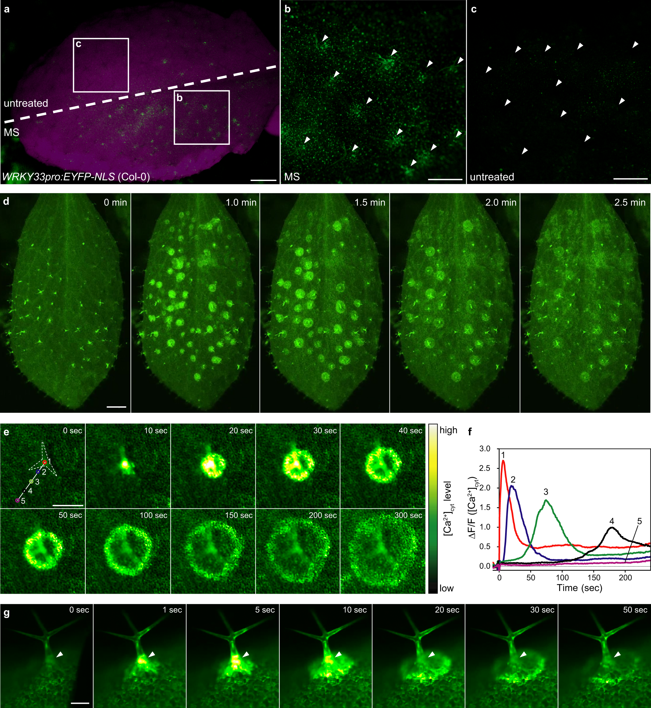
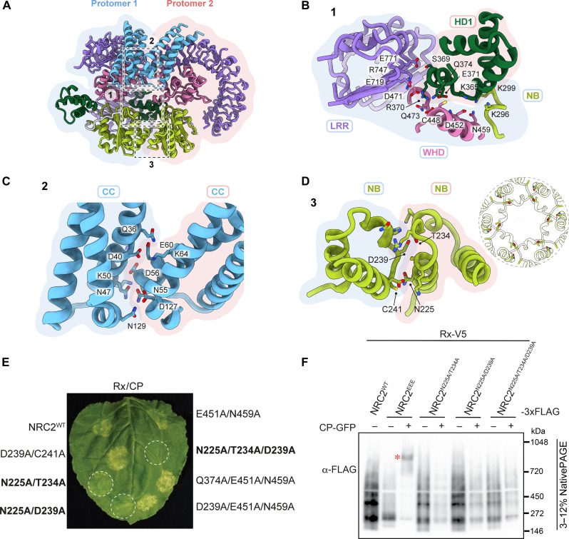
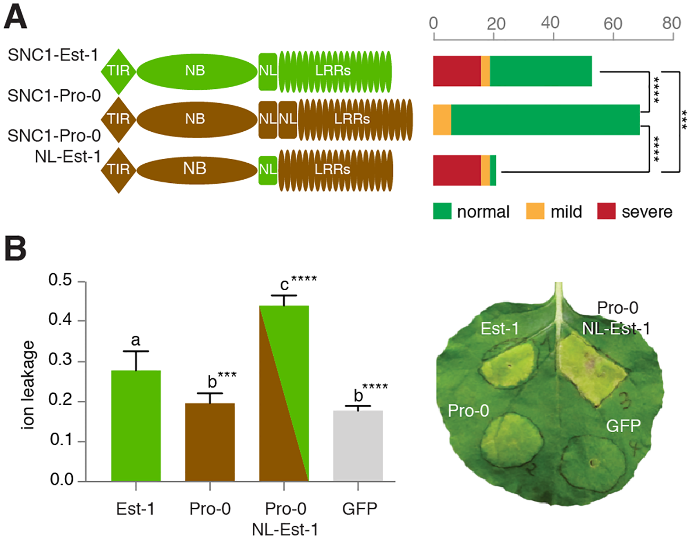

# 钙信号与细胞死亡原图研读：从空间传播到膜完整性

钙报告图、叶片坏死照片和电解质渗漏柱状图都常见于植物免疫论文，但它们测到不同层次。钙报告关注离子相关动态，照片关注组织外观，电解质读数关注膜完整性相关的离子释放。把三者依次读清，才能判断它们怎样支持机制，哪些地方仍需抗病结局证据。

本页接续[第23章](ch23-遗传学与免疫表型研究技术.md)，新增三张真实出版原图和三个分步案例。它们来自**三个不同研究体系**，不能拼成一项实验或一条已经验证的共同通路。图片均按CC BY 4.0许可完整转载，保留原始面板和坐标，点击可放大；中文讲解写在图外。

**学习目标。** 区分报告蛋白的荧光与绝对钙浓度，区分空间测量点与独立重复，读懂HR照片及电解质比值，并将组织损伤、受体激活与抗病保护分开判断。

## 案例一：钙波怎样从一幅亮图变成时空证据 {#case-calcium-waves}

### 研究问题与原图入口

Matsumura等（2022）研究拟南芥表皮毛（trichome）是否参与机械线索感知，并将它与防御联系起来。这个例子的输入是机械刺激，**不是flg22感知实验**。它适合练习荧光传感器、空间传播和时间曲线的基本读法。

{.paper-figure}

**原图补充1｜Matsumura M et al.（2022）Figure 4，a–g。** *Mechanosensory trichome cells evoke a mechanical stimuli–induced immune response in Arabidopsis thaliana.* Nature Communications 13:1216。[论文与图例](https://pmc.ncbi.nlm.nih.gov/articles/PMC8904797/#Fig4) · [DOI](https://doi.org/10.1038/s41467-022-28813-8) · [出版社原图](https://media.springernature.com/full/springer-static/image/art%3A10.1038%2Fs41467-022-28813-8/MediaObjects/41467_2022_28813_Fig4_HTML.png)。© 2022 The Author(s)，[CC BY 4.0](https://creativecommons.org/licenses/by/4.0/)。完整图像未改动，原图信用说明未另列第三方排除。

### 第一步：上半部分和下半部分不是同一种报告

**a–c展示WRKY33启动子驱动的核定位YFP报告。** a中的上、下部分分别标为未处理与机械刺激区域，b、c进一步放大相应位置。它帮助定位防御相关表达发生在哪里。这里看见绿色，首先代表报告系统产生荧光，不能把它直接读成钙浓度。

**d–g才使用GCaMP3钙报告。** GCaMP把钙相关变化转换为荧光变化。相同颜色在不同报告系统中含义不同，因此每次切换面板，必须重新确认构件和检测对象。图a的核内报告与图d的钙成像，不是在同一纵轴上测量“免疫多少”。

### 第二步：先读时间，再看亮区怎样移动

d是叶片尺度的时间序列；e把视野缩小到一个表皮毛及周围组织。注意d中的时间以分钟标注，e以秒标注。对照同一序列中较早和较晚的图像，可以看见亮区从局部出现，随后向周围扩展，而不是整片组织同时变亮。

e中的虚线标出表皮毛轮廓，编号1—5标出不同观察位置。色标的high/low表示相对显示强弱，不是画出了某个已经校准的纳摩尔浓度。比例尺则限定空间范围，不能把这幅局部视野称为“全株钙波”。

### 第三步：把e中的位置接到f的曲线

| 要读的原图元素 | 实际代表什么 | 应怎样解释 |
|---|---|---|
| e中的1—5 | 同一空间场景中的不同取样位置 | 不等于五株植物或五个独立实验 |
| f中的五条曲线 | 相应位置的钙报告动态 | 先对应位置，再比较峰出现的时间 |
| f的横轴 | 时间，单位为秒 | 不同位置的变化有先后，不能只按最大峰排序 |
| f的纵轴ΔF/F | 归一化荧光变化 | 它是报告读数，不是绝对钙浓度或离子通量 |
| g的侧面序列 | 表皮毛基部及周围组织的时间变化 | 为起始空间提供另一观察角度 |

f中靠近起始区域的位置先出现变化，另一些位置较晚，远处位置的响应也较弱。这使“传播”比单张较亮照片更有根据。它仍没有单独证明由哪一种离子通道产生了全部信号，也不能从曲线高低推算通过质膜的钙离子总数。

### 第四步：回头检查对照与结论

a中的处理与未处理区域支持空间比较；时间序列提供变化前的图像；g补充观察角度。原文图例说明多个观察在三个独立实验中得到相似结果，这不等于f已经展示了三个实验的均值和误差线，也不能把五个空间点当成重复数。

**适合的结论：**在所研究的拟南芥背景中，机械刺激伴随从表皮毛附近向周围发展的钙报告变化，并与防御相关表达的空间分布相联系。若要进一步说这些信号提高抗病性，应继续读该论文其他图中的遗传与保护结果；Figure 4本身主要提供定位与动态证据。

## 案例二：HR照片怎样与受体组装证据连接 {#case-hr-assembly}

### 研究问题与原图入口

Madhuprakash等（2024）研究本氏烟草辅助NLR——NbNRC2的组装。其结构分析显示感知受体激活的NbNRC2可形成六聚体。下面展示原Figure 2，第一次优先看**E中的叶片**和**F中的非变性电泳**，再理解A–D为何提出亚基界面的问题。

{.paper-figure}

**原图补充2｜Madhuprakash J et al.（2024）Figure 2，A–F。** *A disease resistance protein triggers oligomerization of its NLR helper into a hexameric resistosome to mediate innate immunity.* Science Advances 10:eadr2594。[论文与图例](https://pmc.ncbi.nlm.nih.gov/articles/PMC11540030/#F2) · [DOI](https://doi.org/10.1126/sciadv.adr2594) · [PMC原图](https://cdn.ncbi.nlm.nih.gov/pmc/blobs/1b1f/11540030/4cea8f72e269/sciadv.adr2594-f2.jpg)。© 2024 The Authors；exclusive licensee AAAS；[CC BY 4.0](https://creativecommons.org/licenses/by/4.0/)。完整图像未改动，原图信用说明未另列第三方排除。

### 第一步：照片给的是指定背景中的组织输出

E比较的是同一研究背景下的不同**宿主辅助受体版本**。背景植物缺少相关NRC辅助成员，原研究用这一背景判断恢复何种宿主受体后可以产生相应输出；Rx是感知受体，CP是被识别的病毒蛋白线索。这里读的是已发表材料之间的比较，不是病毒在植物内增殖的定量。

原图中某些区域有明显黄化或坏死样改变，另一些区域反应较弱；虚线圈出部分比较位置。应先看标签再描述差异，不能把图中每个区域都当成独立植株。照片为论文所用HR相关组织表型提供直观记录，却没有单独给出死亡细胞百分比或抗病程度。

**HR（hypersensitive response，超敏反应）是一类免疫相关局部细胞死亡现象。** 当受体背景、识别条件和功能证据已经明确时，照片可成为HR证据的一部分。任意叶片坏死则可能来自其他损伤，不能只凭外观完成受体或死亡机制的鉴定。

### 第二步：F关注组装，不是又拍了一次HR

F中的`− / +`关注所示识别线索的状态；泳道上方列出不同NRC2版本。原图标明使用native PAGE，即保留较大复合体状态的电泳，而不是只按完全变性单体比较的普通SDS-PAGE。红星号指向原文关注的高阶组装信号，**不是统计显著性的星号**。

比较时先确认泳道的蛋白版本和条件，再看是否出现对应的高分子量信号。不同版本的组织表型与组装读数相互补充，但不能把条带迁移位置直接除以单体分子量，就宣布精确数出六个亚基。这里六聚体的直接结构依据来自同一论文的冷冻电镜Figure 1；非变性电泳与结构回答的是相邻问题。

### 第三步：哪些控制来自其他图

| 面板或证据 | 回答什么 | 单独看它还缺什么 |
|---|---|---|
| A–D结构接触 | 相邻亚基可能怎样形成界面 | 结构接触是否影响植物输出，需要功能比较 |
| E叶片照片 | 指定背景中的组织表型是否改变 | 蛋白是否表达、损伤是否具有受体依赖、重复如何分布 |
| F非变性电泳后的免疫印迹 | 某些条件下是否检出高阶组装信号 | 各版本的总量与完整性不能仅从一条复合体信号判断 |
| 原论文补充材料中的表达检查 | 功能差异能否仅用丰度不足解释 | 相近表达仍不保证所有其他功能均保持 |

原图例说明实验重复三次并有相似结果；它不是把E中一片叶子的多个区域变成三个重复。原文另有变性免疫印迹和表达证据，读者应回到补充材料核对，不能假装它们已经全部包含在F中。

**适合的结论：**这组研究把宿主受体组装与HR相关输出联系起来，结构证据支持NbNRC2的六聚体架构。眼前的照片与非变性电泳条带没有直接测量离子电流、病毒负担或田间保护；这些结论需要相应证据。有关CNL结构多样性的概念衔接，见[第4章](../part2-分子机制/ch04-NLR与抗病小体.md#nrc-hexamer)。

## 案例三：电解质渗漏的0.3，为什么不是“30%的细胞死亡” {#case-ion-leakage}

### 研究问题与原图入口

Zhu等（2018）研究拟南芥NLR蛋白SNC1的自然变异与自身免疫。其Figure 5包含拟南芥转基因材料的坏死类别，以及本氏烟草中的离子渗漏和代表性叶片照片。这个例子特别适合说明：**组织出现死亡输出，可以源于宿主免疫系统自身活动，并不自动证明识别了病原。**

{.paper-figure}

**原图补充3｜Zhu W et al.（2018）Figure 5，A、B。** *Modulation of ACD6 dependent hyperimmunity by natural alleles of an Arabidopsis thaliana NLR resistance gene.* PLOS Genetics 14:e1007628。[论文与图例](https://journals.plos.org/plosgenetics/article?id=10.1371/journal.pgen.1007628#pgen-1007628-g005) · [DOI](https://doi.org/10.1371/journal.pgen.1007628) · [出版社原图](https://journals.plos.org/plosgenetics/article/figure/image?download&size=large&id=10.1371/journal.pgen.1007628.g005)。© 2018 Zhu et al.，[CC BY 4.0](https://creativecommons.org/licenses/by/4.0/)。完整图像未改动，原图信用说明未另列第三方排除。

### 第一步：把两个宿主背景分开

A左侧是蛋白版本示意，右侧是拟南芥转基因植株的正常、轻度与严重表型类别。横向条形图显示类别计数，三组总数不同；比较类别所占比例时，必须同时考虑各自的分母。它不是逐个细胞的死亡测量。

B左侧才是本氏烟草叶片的`ion leakage`，右侧为代表性叶片外观。材料名称看上去相似，不表示A、B测的是同一种样本，也不能把两个物种中的强弱直接换算成同一个比例。

### 第二步：读清“离子渗漏”的分子与分母

本研究方法用所测离子释放读数C1与总离子释放参照C2的比值，形成离子渗漏指标。这个归一化帮助比较组织释放离子的相对程度，但**C1/C2不是死亡细胞数除以总细胞数**。

纵轴约0.3这样的读数，应按该研究的比值定义理解。不同细胞的离子储备、组织组成和膜状态会影响测量；一个细胞也可以在不同程度上改变离子通透性。因此，不能把它翻译成“30%的细胞已经死亡”，更不能进一步写成“免疫增强30%”。

### 第三步：找对照，再读显著性

B中GFP是报告背景参照，Est-1、Pro-0等标签表示不同SNC1相关版本。Pro-0的离子渗漏较低，另一些版本较高；这与照片中组织反应的差异相互呼应。**参照本身存在非零读数很正常**，因为组织不是没有背景的纯净电路。

原图同时使用字母和星号，图例给出了不同的比较与多重比较校正。星号与字母不能任意替换；某两个柱子共享字母，讨论的是作者所定义检验中的结果，而不是严格证明两组完全等同。

图例说明叶样来自六株独立植物。判断重复层级时，应保留植物来源；一株植物贡献的多个叶圆片或同一样本的多次电导读数，不能自动变成新的独立植物。图例与方法段对离子渗漏采样日的表述不完全一致，照片又属于另一观察时间，所以本书不把柱子与照片当作同一时刻的逐点校准。

### 第四步：让结论停在实际读数上

**适合的结论：**不同宿主受体版本在所用表达背景下具有不同的膜完整性相关离子释放与组织表型。这为功能差异提供支持，但不能仅凭B就断定某版本在自然表达水平下更抗病，也不能认定每个坏死区都由病原识别所触发。

做跨论文比较时还要检查：纵轴是原始电导率、相对比值还是百分数？是否减去了背景？观察时间与组织是否一致？只有名称都叫“ion leakage”，不能保证纵轴可以直接叠到一张图上。

## 把三例接回一条证据逻辑

| 如果论文想说明…… | 本页图像提供了什么 | 还需接上的证据 |
|---|---|---|
| 组织存在传播性钙信号 | 空间序列与位置对应曲线 | 具体通道身份、来源和因果作用 |
| 受体激活影响死亡输出 | 指定背景中的HR相关照片与组装比较 | 蛋白状态、识别依赖和独立重复 |
| 膜完整性相关输出改变 | 按定义归一化的离子渗漏指标 | 特异死亡机制及宿主保护结局 |
| 植物因此更抗病 | 上述结果提供机制线索 | 病原负担、疾病与宿主损失的直接评价 |

钙上升不必导致HR，HR也不必代表病原受到限制。最稳妥的写法是先描述测量，再连接机制，最后核对植物是否真正受益。与[第20章证据阅读](../part6-专题与研读/ch20-如何阅读植物免疫证据.md)及[拟南芥贯穿案例](../learning/拟南芥模式系统贯穿案例.md)配合，可把这三步应用到其他论文。

## 自测与解析

**1. Matsumura原图a中的核内荧光和d中的绿色信号是否都直接代表钙？**

不是。a–c是WRKY33启动子报告，d–g是GCaMP3钙报告。面板之间需要重新确认检测对象。

**2. 钙图中的五个空间位置，是否就是五个独立生物学重复？**

不是。它们可以来自同一组织和同一刺激事件，主要提供空间信息。独立重复应根据实验来源判断。

**3. 非变性电泳中的高分子量条带是否已经精确证明有六个亚基？**

没有。迁移还受复合体状态等因素影响。NRC2六聚体的直接架构证据来自结构分析，不能由简单除法代替。

**4. 某一区域出现坏死，是否足以把它判为特定NLR触发的HR？**

不足。还需要识别背景、宿主受体依赖和适当对照；其他损伤也能造成类似外观。

**5. 电解质比值为0.3是否表示30%的细胞死亡？**

不是。分子、分母是离子释放相关测量，不是细胞计数。应按原文归一化定义解释。

**6. 钙、坏死和离子渗漏都增强，能否直接说更抗病？**

不能。这些是不同响应或损伤读数，保护需要相应的病原负担与宿主结局证据；三种变化也可能来自失控的免疫活动。

## 参考文献

- Matsumura M et al. *Mechanosensory trichome cells evoke a mechanical stimuli–induced immune response in Arabidopsis thaliana.* Nature Communications, 2022;13:1216. [DOI](https://doi.org/10.1038/s41467-022-28813-8)。
- Madhuprakash J et al. *A disease resistance protein triggers oligomerization of its NLR helper into a hexameric resistosome to mediate innate immunity.* Science Advances, 2024;10:eadr2594. [DOI](https://doi.org/10.1126/sciadv.adr2594)。
- Zhu W et al. *Modulation of ACD6 dependent hyperimmunity by natural alleles of an Arabidopsis thaliana NLR resistance gene.* PLOS Genetics, 2018;14:e1007628. [DOI](https://doi.org/10.1371/journal.pgen.1007628)。

[返回技术案例导览](index.md) · [原图来源与使用说明](原图来源与使用说明.md)
